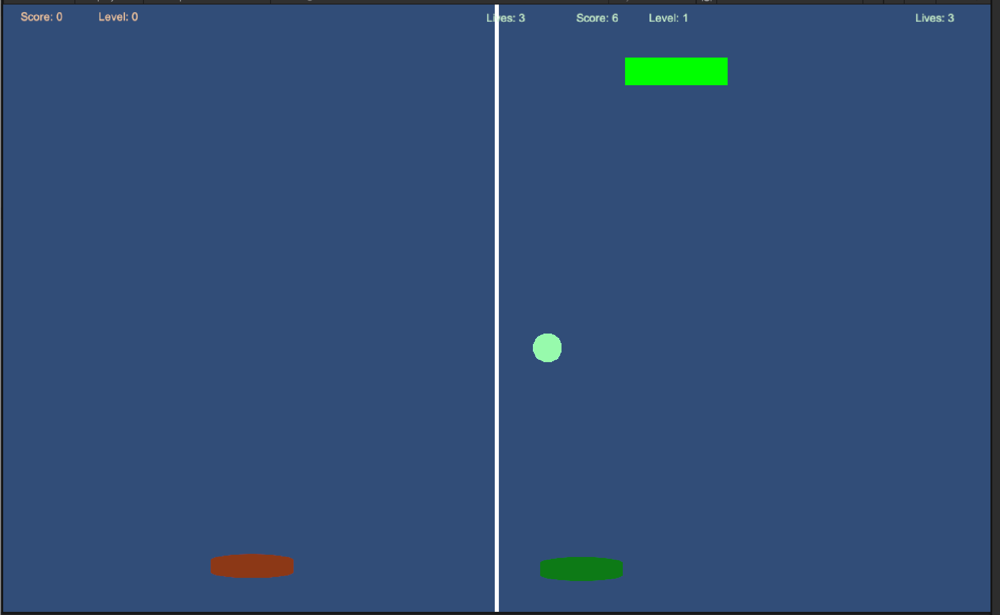

# 🧩 ML Breakout - Reinforcement Learning AI Project

Build a replica of Atari’s Breakout and train a neural network with reinforcement learning algorithms from Unity ML-Agents to play the game.

<!-- <p align="center"> -->
  
<!-- </p> -->

## Project Description

This project aims to recreate the classic game Atari Breakout in Unity and implement a neural network trained with reinforcement learning algorithms using Unity ML-Agents with Pytorch to play the game autonomously.

## Features

- **Replica of Atari Breakout**: An inspired recreation of the classic game.
- **Reinforcement Learning**: Train a neural network to play Breakout using Unity ML-Agents.
- **2-Player Mode**: Play against the trained AI to see how it performs against a human.

<br>
<p>
  
</p>


---

<br>


# 📦 Unity ML Agents Toolkit Setup

This guide provides step-by-step instructions to set up the ML Agents toolkit in Unity, including Python installation, creating a virtual environment, and installing necessary packages.

## Prerequisites

- Unity installed on your machine
- Basic knowledge of using command line

## Installation Steps

### 1. Python Installation

1. **Download Python:**
   - Recommended version: 3.9.13
   - Download from [Python.org](https://www.python.org/downloads/).

2. **Verify Installation:**
   - Open the command prompt and type:
     ```bash
     py --version
     ```
   - If typing `python` opens the Microsoft Store instead of running Python, use `py` instead.

### 2. Creating a Virtual Environment

1. **Navigate to Your Unity Project Directory:**
   - Open the command prompt and navigate to your Unity project directory:
     ```bash
     cd path/to/your/unity/project
     ```

2. **Create and Activate a Virtual Environment:**
   - Create a virtual environment using Python 3.9:
     ```bash
     py -3.9 -m venv venv
     ```
   - Activate the virtual environment:
     - **Windows:**
       ```bash
       venv\Scripts\activate
       ```
     - **Mac/Linux:**
       ```bash
       source venv/bin/activate
       ```

### 3. Package Installation

1. **Update pip:**
   - Ensure `pip` (Python package installer) is up-to-date:
     ```bash
     python -m pip install --upgrade pip
     ```

2. **Install ML Agents Package:**
   - Install the ML Agents package using `pip`:
     ```bash
     pip install mlagents
     ```

3. **Install PyTorch and Related Packages:**
   - Install PyTorch, Torchvision, and Torchaudio:
     ```bash
     pip3 install torch torchvision torchaudio
     ```

4. **Install Protobuf:**
   - Install a specific version of Protobuf for compatibility:
     ```bash
     pip install protobuf==3.20.3
     ```

5. **Install Packaging:**
   - Install the packaging library:
     ```bash
     pip install packaging
     ```

### 4. (Optional) Install CUDA Libraries for Nvidia GPU

   - If you have an Nvidia GPU and want to leverage it for training, install the CUDA toolkit.
   - **Check Missing Libraries:**
     - During installation, if you see warnings about missing libraries (e.g., `cudart64_101.dll`), it indicates the need for specific CUDA versions.
   - **Download and Install CUDA:**
     - Visit the [Nvidia CUDA download page](https://developer.nvidia.com/cuda-downloads) and download the version matching the missing library (e.g., CUDA 10.1).
     - Follow the installation instructions provided by Nvidia.
   - **Install cuDNN Library:**
     - Download the [cuDNN library](https://developer.nvidia.com/cudnn) compatible with your CUDA version.
     - Extract the downloaded files and copy them into the corresponding CUDA directories (`bin`, `include`, `lib`).

## Additional Resources

- [ML-Agents Toolkit Documentation](https://github.com/Unity-Technologies/ml-agents/tree/main/docs)
- [Unity ML-Agents Toolkit](https://github.com/Unity-Technologies/ml-agents)
- [Python.org](https://www.python.org/downloads/)
